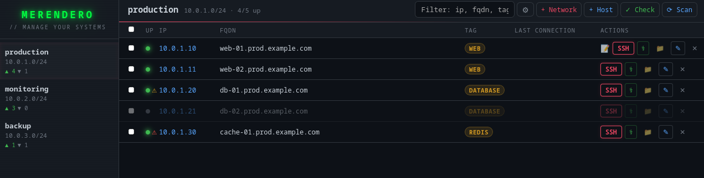
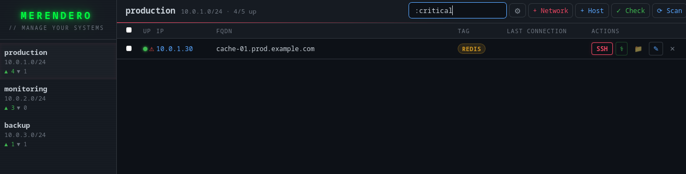
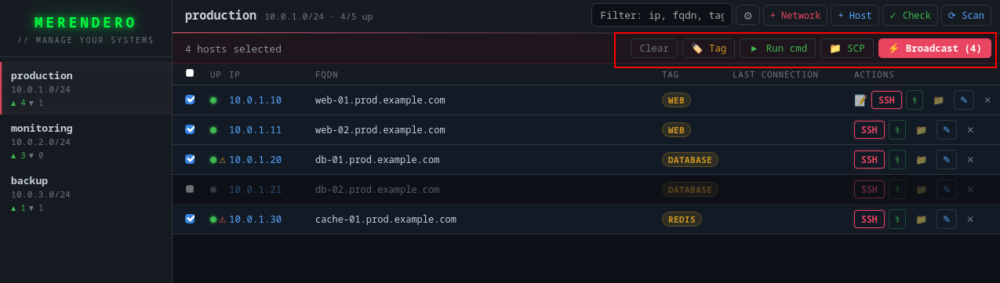

# 🥪 Merendero

> A modern SSH connection manager for Linux sysadmins — with network scanning, broadcast commands, health checks and AI-powered analysis.


## Why Merendero?

Most SSH managers are either too simple (just a list of hosts) or too complex (full-blown orchestration tools). Merendero sits in the middle: it automatically discovers hosts on your networks, keeps them organized, and lets you operate on many of them at once.

Built by a sysadmin, for sysadmins.

## Screenshots

### Main view — networks, hosts, health status and tags


### Smart filtering — `:critical` shows only hosts with health issues


### Multi-host selection — broadcast SSH, run commands, SCP to all at once


## Features

- **Network scanning** — scan a CIDR range, auto-discover hosts with SSH open and resolve their FQDNs via reverse DNS
- **Smart timeout calibration** — automatically measures network latency and sets the optimal scan timeout per network
- **Broadcast SSH** — select multiple hosts and open tmux sessions with `synchronize-panes` enabled
- **Run commands** — execute a command on multiple hosts in parallel and see the output inline
- **SCP** — upload/download files to individual hosts or broadcast to many at once, with remote file browser
- **Health check** — run Brendan Gregg's 60-second performance checklist on any host, with local analysis and optional AI insights
- **Connection history** — track when you last connected to each host
- **Tags** — tag hosts individually or in bulk for easy filtering
- **Notes** — add notes to any host
- **SSH key management** — per-host, per-network or global identity file
- **Post-connect commands** — run a command automatically on connect (e.g. `sudo su -`)
- **Backup & restore** — export and import all your configuration
- **AI analysis** — connect any OpenAI-compatible API (Claude, OpenAI, Ollama...) for intelligent health insights
- **Dark hacker aesthetic** — because sysadmins deserve nice things too

## Installation

### Prerequisites

- Linux (tested on Arch Linux)
- `ssh`, `scp`, `tmux` in your PATH
- A terminal emulator (`terminator`, `alacritty`, `kitty`, `xterm`...)

### From release

Download the latest `.AppImage` or `.deb` from the [releases page](../../releases).

```bash
# AppImage
chmod +x merendero_*.AppImage
./merendero_*.AppImage

# Debian/Ubuntu
sudo dpkg -i merendero_*.deb
```

### From source

```bash
# Prerequisites — Arch Linux
sudo pacman -S rustup nodejs npm tmux

# Prerequisites — Debian/Ubuntu
sudo apt install rustup nodejs npm tmux

rustup default stable

# Clone and build
git clone https://github.com/yourusername/merendero.git
cd merendero
npm install --prefix frontend
tauri build

# Install
sudo cp src-tauri/target/release/app /usr/local/bin/merendero
```

## Quick start

1. Launch `merendero`
2. Click **+ Network** and enter a CIDR range (e.g. `192.168.1.0/24`)
3. Click **⟳ Scan** — Merendero discovers hosts and resolves their FQDNs via reverse DNS
4. Click **SSH** to connect, or select multiple hosts for **⚡ Broadcast**

## Configuration

On first run, Merendero creates `~/.config/merendero/` with:

- `config.toml` — global defaults (username, port, DNS server, terminal, AI config)
- `networks.toml` — your networks and discovered hosts
- `history.toml` — connection history

### config.toml example

```toml
[defaults]
username = "root"
port = 22
dns_server = "10.0.0.1"      # for PTR resolution
terminal = "terminator"       # or alacritty, kitty, xterm...

[ai]                          # optional
provider = "claude"
api_url = "https://api.anthropic.com/v1/messages"
api_key = "sk-ant-..."
model = "claude-haiku-4-5"
```

## Filter syntax

| Filter | Shows |
|--------|-------|
| `text` | hosts matching IP, FQDN or tag |
| `:critical` | hosts with critical health status |
| `:warning` | hosts with warning health status |
| `:issues` | hosts with any health problem |
| `:down` | hosts with SSH port closed |
| `:up` | hosts with SSH port open |
| `:healthy` | hosts with clean health check |

## CLI mode

A terminal CLI is also available as `merendero-cli`.

## Tech stack

- **Backend**: Rust + Tauri
- **Frontend**: React + Vite
- **SSH/SCP**: OpenSSH system binaries
- **Broadcast**: tmux with synchronize-panes
- **DNS**: hickory-resolver
- **Network scan**: tokio async with semaphore-limited concurrency

## License

GPLv3 — free software, forever. If you improve Merendero, share the improvements.

## Contributing

Issues and PRs welcome. This is a tool built out of real sysadmin pain — if you have a workflow that Merendero doesn't cover, open an issue.

## Author

Built by a Linux sysadmin who got tired of managing hundreds of hosts by hand.

⭐ If Merendero saves you time, a star goes a long way.
