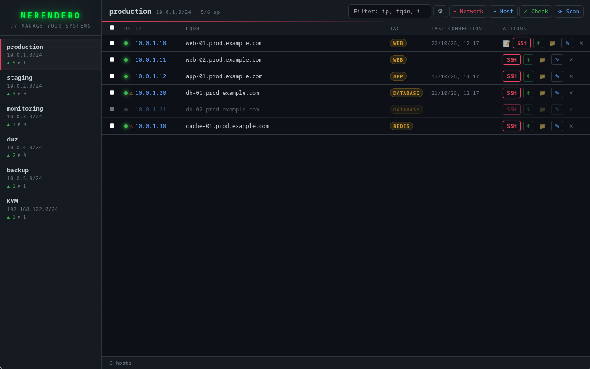
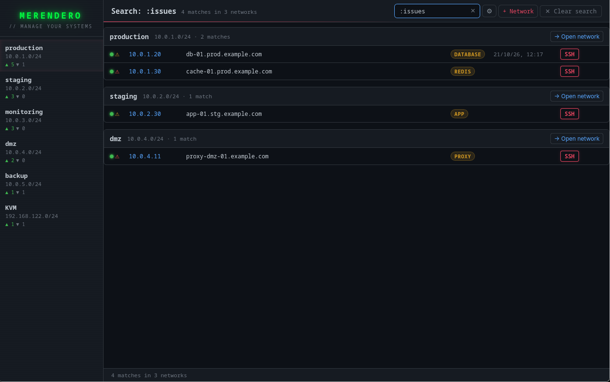
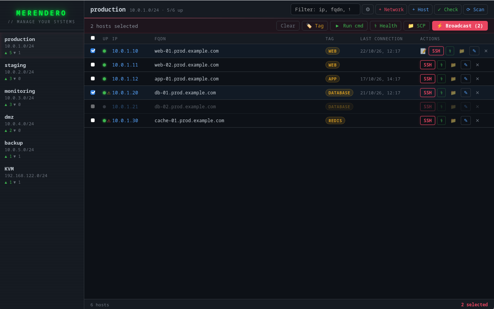
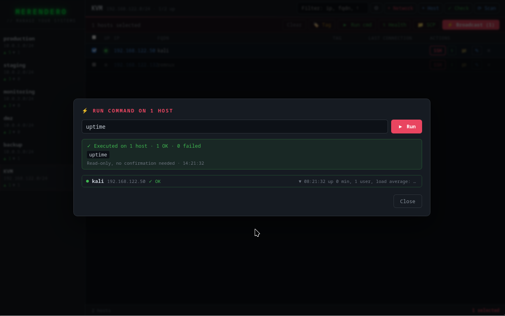
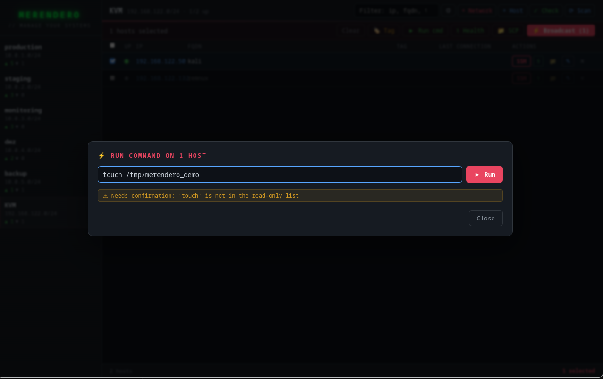

# 🥪 Merendero

> A modern SSH connection manager for Linux sysadmins — with network scanning, broadcast commands, health checks and AI-powered analysis.


## Why Merendero?

Most SSH managers are either too simple (just a list of hosts) or too complex (full-blown orchestration tools). Merendero sits in the middle: it automatically discovers hosts on your networks, keeps them organized, and lets you operate on many of them at once.

Built by a sysadmin, for sysadmins.

## Screenshots

The hosts in these screenshots are made up, except in the two Run cmd ones, which ran on lab virtual machines.

### Main view — networks, hosts, health marks, tags and last connection


### Global search — one filter box searches every network and groups the matches by network


### Selection toolbar — tag, run a command, check health, copy files or broadcast to several hosts at once


### Run cmd — a result for each host and an execution receipt of what was run and how it was approved


### Confirmation — Run cmd checks every command, and anything that isn't clearly read-only needs confirmation before it runs


## Features

**Discover and organize**

- **Network scanning** — scan a CIDR range, find hosts with SSH open and resolve their FQDNs through reverse DNS. A prefix such as `/24` is required, so a typo can't silently scan a single host
- **Timeout calibration** — measures latency per network and sets the scan timeout for you
- **Automatic availability check** — while Merendero is open, it re-checks which known hosts answer every 15 minutes (you can change that or turn it off), and shows its state in the footer with a Pause button. Scans stay manual
- **Global search** — one filter box searches every network and groups the matches by network. `:critical`, `:warning`, `:issues`, `:down`, `:up` and `:healthy` work as filters
- **Tags, notes and history** — tag hosts one by one or in bulk, keep notes on each host and see when you last connected

**Connect and operate**

- **SSH** — one click, with a per-host, per-network or global key and an optional command to run on connect (for example `sudo su -`)
- **Broadcast SSH** — open synchronized tmux panes on the selected hosts, after a pre-flight check that skips hosts that don't answer. tmux broadcast is fire-and-forget: use Run cmd when you need to know what happened on each host
- **Run cmd** — run one command on many hosts in parallel, with a result for each host and an execution receipt
- **SCP** — upload or download files for one host, or send a file to many at once. There is a local file picker, and a remote file browser for single-host transfers

**Health checks**

- **Brendan Gregg's 60-second checklist** on any host or on a whole selection (8 at a time), with a local analysis and a status mark in the host table
- **Health history** — each check is kept for 90 days by default (you can change that in Settings), and the host window shows what changed since the previous one

**Optional AI** (Claude, OpenAI, Ollama or a custom endpoint)

- **Host report** with a diagnosis and suggested fix commands for the issues it finds. Review them before running anything
- **Fleet summary** that groups the hosts flagged in a batch check, built from the local findings and not from the raw output
- **Command suggestions** in Run cmd: describe what you want and it proposes a command. It never runs it by itself, and commands that aren't clearly read-only need you to type the number of hosts to confirm

**Records and backup**

- **Audit log** of what you run from Merendero (SSH sessions, commands, transfers, broadcasts and AI requests), kept locally. It helps you keep track; it is not tamper-proof
- **Backup and restore** of your configuration, including the audit log and the health history
- **Dark interface** — because sysadmins deserve nice things too

## Installation

### Prerequisites

- Linux. Arch Linux is the only distribution it has been tested on
- `ssh` and `scp` in your PATH, and `tmux` for broadcast
- A terminal emulator. `terminator` is the default, and `alacritty` and `kitty` have their own support. Any other, such as `xterm` or `xfce4-terminal`, is started as `<terminal> -e "<command>"`; a terminal that expects the command as separate arguments may not work

### From release

Download a file from the [releases page](../../releases). All of them are built on Arch Linux and have only been tested there. If one doesn't work on your system, build from source.

| File | Use it for |
|------|------------|
| `merendero_*_amd64.AppImage` | Most x86_64 distributions. Self-contained, but it needs FUSE 2 (`fuse2` on Arch, `libfuse2` on Debian/Ubuntu) |
| `merendero_*_amd64.deb` | Debian, Ubuntu and derivatives |
| `merendero-*.x86_64.rpm` | Fedora and other RPM-based distributions |
| `merendero-*-x86_64-linux` | The bare executable. It needs WebKitGTK 4.1 (`webkit2gtk-4.1` on Arch, `libwebkit2gtk-4.1-0` on Debian/Ubuntu) and OpenSSL 3 installed |

```bash
# AppImage
chmod +x merendero_*.AppImage
./merendero_*.AppImage

# Debian/Ubuntu (apt also installs the dependencies)
sudo apt install ./merendero_*.deb

# Fedora
sudo dnf install ./merendero-*.x86_64.rpm

# Bare executable
chmod +x merendero-*-x86_64-linux
sudo cp merendero-*-x86_64-linux /usr/local/bin/merendero
```

### From source

You need Rust 1.90 or newer, Node.js 20.19 or newer (22.12 or newer also works), and the system libraries that Tauri requires.

**1. System dependencies**

```bash
# Arch Linux
sudo pacman -S --needed webkit2gtk-4.1 base-devel curl wget file openssl \
    appmenu-gtk-module libappindicator-gtk3 librsvg xdotool rustup nodejs npm tmux

# Debian/Ubuntu
sudo apt install libwebkit2gtk-4.1-dev build-essential curl wget file libxdo-dev \
    libssl-dev libayatana-appindicator3-dev librsvg2-dev rustup nodejs npm tmux

rustup default stable
```

For other distributions, see the [Tauri prerequisites](https://v2.tauri.app/start/prerequisites/). Check `node --version`: on Debian and Ubuntu the packaged Node.js may be older than the frontend needs.

**2. Tauri CLI**

```bash
npm install -g @tauri-apps/cli      # use sudo if npm installs globally into a system directory
```

Alternatively, `cargo install tauri-cli --version "^2.0.0" --locked`, and then use `cargo tauri` wherever this page says `tauri`.

**3. Build and install**

```bash
git clone https://github.com/c0r3dump3d/merendero.git
cd merendero
npm install --prefix frontend
tauri build
sudo cp src-tauri/target/release/app /usr/local/bin/merendero
```

The first build compiles hundreds of dependencies, so it takes a while. `tauri build` also creates the `.deb`, `.rpm` and AppImage packages in `src-tauri/target/release/bundle/`; add `--no-bundle` to build only the executable.

## Quick start

1. Launch `merendero`. On a first run the window is empty
2. Open **Settings** (⚙) and set what you need: the default SSH username (`root` until you change it), your terminal emulator (`terminator` is the default; type the name of the one you use, such as `alacritty`, `kitty`, `xterm` or `xfce4-terminal`) and, if you want, a DNS server for reverse lookups (by default Merendero uses your system's)
3. Click **+ Network** and enter a name and a CIDR range with its prefix, such as `192.168.1.0/24`
4. Click **⟳ Scan**. Merendero finds the hosts with the SSH port open and looks up their names with reverse DNS. The first scan of a network also measures its latency, so it takes a little longer. Later, **✓ Check** re-tests the hosts you already have
5. Click **SSH** on a host to open a terminal with the session. It uses your normal SSH setup (agent and default keys) unless you set a key for the host, the network or globally
6. Tick several hosts to get the toolbar: **Tag**, **Run cmd**, **Health**, **SCP** and **⚡ Broadcast**. The ⚕ button on a row runs a health check on that host

If the SSH button reports that it could not launch the terminal, choose an installed terminal in Settings.

## Configuration

Merendero keeps its data in `~/.config/merendero/`:

- `config.toml` — global defaults (username, port, DNS server, terminal, SSH key), the monitoring settings and the optional AI settings
- `networks.toml` — your networks and hosts, with tags, notes and the latest health result of each host
- `history.toml` — when you last connected to each host
- `audit.jsonl` — what you ran from Merendero, one JSON object per line. Commands are stored as typed, so don't put passwords in them
- `health_history.jsonl` — the health check history, kept for 90 days by default

You normally don't edit these by hand: the defaults, the monitoring settings and the AI settings live in the Settings window (⚙), and networks and hosts are managed from the main window.

`config.toml` can hold your AI API key in plain text, and the backup you export from Settings includes it, so keep both private: `chmod 600 ~/.config/merendero/config.toml`.

### config.toml example

```toml
[defaults]
username = "root"
port = 22
dns_server = "10.0.0.1"               # optional, for reverse lookups; the system's DNS if unset
terminal = "terminator"               # or alacritty, kitty, xterm...
identity_file = "~/.ssh/id_ed25519"   # optional default SSH key

[monitoring]                          # optional
check_interval_minutes = 15           # automatic availability check; 0 turns it off
history_days = 90                     # how long the health history is kept; 0 keeps everything

[ai]                                  # optional
provider = "claude"
api_url = "https://api.anthropic.com/v1/messages"
api_key = "sk-ant-..."
model = "claude-haiku-4-5"
```

### Automatic check

While Merendero is open, it checks the known hosts of every network every 15 minutes by default. It opens a TCP connection to each host's SSH port, the same thing the ✓ Check button does, so your IDS may see it as a sweep. Scans are never automatic.

- Change the interval in Settings (⚙), under Monitoring, or with `check_interval_minutes`. `0` turns it off for good
- The **Pause** button in the footer stops it until you close Merendero
- It doesn't run while a dialog is open or another operation is in progress; it tries again a minute later
- If every host of a network stops answering at once, it keeps the previous state, assuming this machine lost its connection (VPN, Wi-Fi). The ✓ Check button doesn't do this, so use it to confirm a real outage

### AI settings (optional)

Choose the provider in Settings (⚙). The AI buttons only appear once it is configured.

| `provider` | Use it for | `api_key` |
|------------|------------|-----------|
| `claude` | The Anthropic API | required |
| `openai` | OpenAI, or a server that speaks the OpenAI chat format (set `api_url`) | required |
| `ollama` | A local Ollama server | not needed |
| `custom` | A local endpoint without authentication | not needed |

For a local Ollama server no key is needed:

```toml
[ai]
provider = "ollama"
api_url = "http://localhost:11434/api/chat"
model = "llama3"                      # use a model you have pulled
```

Local endpoints (`ollama` and `custom`) are new and so far have only been tested against a simulated server, not against real models. If something doesn't work, please open an issue.

### What the AI features send

Nothing is sent until you press an AI button.

- **Host report:** the host name and the raw output of the health checklist (processes, mounts, kernel messages, OS release), plus the local findings
- **Fleet summary:** host names, IPs and the local findings of the flagged hosts, not the raw output
- **Command suggestions:** only the text you type in the description box

With Ollama on `localhost`, nothing leaves your machine.

## Filter syntax

| Filter | Shows |
|--------|-------|
| `text` | hosts matching IP, FQDN or tag |
| `:critical` | hosts with critical health status |
| `:warning` | hosts with warning health status |
| `:issues` | hosts with any health problem |
| `:down` | hosts with SSH port closed |
| `:up` | hosts with SSH port open |
| `:healthy` | hosts with clean health check |

## Tech stack

- **Backend**: Rust + Tauri
- **Frontend**: React + Vite
- **SSH/SCP**: OpenSSH system binaries
- **Broadcast**: tmux with synchronize-panes
- **DNS**: hickory-resolver
- **Network scan**: tokio async with semaphore-limited concurrency

## License

GPLv3 — free software, forever. If you improve Merendero, share the improvements.

## Contributing

Issues and PRs welcome. This is a tool built out of real sysadmin pain — if you have a workflow that Merendero doesn't cover, open an issue.

## Author

Built by a Linux sysadmin who got tired of managing hundreds of hosts by hand.

⭐ If Merendero saves you time, a star goes a long way.
